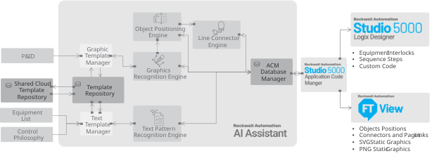

# Solutions Project Accelerator

Solutions Project Accelerator is a Windows desktop app that extracts design
information from piping and instrumentation diagrams (P&IDs), control
philosophies, and equipment lists using computer vision, OCR, and feature
matching, then uses that information to accelerate PLC code and HMI display
work. Every extracted artifact keeps a reference back to the source document,
so engineers can review each other's work against the original design.

The app has four capabilities:

* Extract static graphic templates from P&IDs while keeping a reference to the
  source document, then find visually similar graphics to align HMI style.
* Position process objects and static graphics onto HMI displays based on
  their relative positions on the P&ID within a user-defined area.
* Extract pipeline connections between engineer-selected equipment and plot
  them onto HMI displays to show how process objects interconnect.
* Extract code from control philosophies by comparing interlock or sequence
  text, again keeping a reference to the source document to aid code
  alignment.

## Block diagram

The app can be broken down into a number of functional blocks, illustrated
below.



## Prerequisites

* Windows 10 / 11 x64.
* [Python 3.12](https://www.python.org/downloads/) (tick "Add python.exe to
  PATH" in the installer). The virtual environment is created below.
* Git.
* ~20 GB free disk if you plan to build the packaged app.
* An internet connection for the first-time engine fetch
  ([build_scripts/setup_vendor_deps.ps1](build_scripts/setup_vendor_deps.ps1),
  ~120 MB download).
* For building the Rockwell PLC sidecar only: Studio 5000 Logix Designer SDK
  wheel and FactoryTalk Logix Echo SDK wheel (see
  [plc_bridge/README.md](plc_bridge/README.md)).
* **Native Cairo** for the `CairoSVG`/`cairocffi` deps: `pip install` only gets
  the Python bindings, not the `libcairo-2.dll` they call into. Install the
  [GTK3 Runtime for Windows](https://github.com/tschoonj/GTK-for-Windows-Runtime-Environment-Installer/releases)
  (check "Set up PATH environment variable" in the installer) and open a new
  terminal before installing `requirements.txt`. See Troubleshooting below if
  you skip this and hit an `OSError` on `import cairosvg`.

## Quick start (run from source)

```powershell
# 1. Fresh environment
py -3.12 -m venv .venv
.\.venv\Scripts\Activate.ps1

# 2. Bootstrap packages needed by a couple of legacy sdists
#    setuptools is capped: 81+ dropped pkg_resources, which PyInstaller's
#    paddleocr hooks import at build time.
python -m pip install --upgrade pip
python -m pip install numpy==1.26.4 cython==3.0.10 patch-ng "setuptools<81" wheel

# 3. Main runtime deps
python -m pip install -r requirements.txt --no-build-isolation

# 4. Vendored engine binaries (Potrace, PaddleOCR models).
#    Not in git. Potrace comes from upstream; the PaddleOCR weights are
#    resolved from the pip-installed `paddleocr` package, so run this
#    after step 3. Everything is checksummed.
powershell -ExecutionPolicy Bypass -File build_scripts/setup_vendor_deps.ps1

# 5. Run it
python runme.py
```

`--no-build-isolation` is required because a few legacy sdists in the
dependency tree (`pyastar2d`, `py-lmdb`) declare setup-time dependencies on
`numpy`, `cython`, and `patch-ng` that must already be present in the target
environment.

## Build the packaged app

The build produces `dist\runme\runme.exe` plus a `rockwell_plc_bridge.exe`
sidecar. Two virtual environments are needed because the main app pins
`numpy < 2` (via `paddleocr`, `imgaug`, `numba`) while the Rockwell
`logix_designer_sdk` and `ftecho_sdk` wheels require `numpy >= 2`. The
sidecar isolates that conflict.

1. One-time sidecar env + smoke test:

    ```powershell
    powershell -ExecutionPolicy Bypass -File build_scripts/setup_plc_bridge_dev.ps1
    ```

2. Full two-stage build (sidecar, then main app):

    ```powershell
    powershell -ExecutionPolicy Bypass -File build_scripts/build_all.ps1
    ```

Outputs:

* `plc_bridge/dist/rockwell_plc_bridge/rockwell_plc_bridge.exe` — sidecar.
* `dist/runme/runme.exe` — main app, with the sidecar embedded under
  `_internal/rockwell_plc_bridge/`.

See [plc_bridge/README.md](plc_bridge/README.md) for the sidecar's CLI and
manual build steps.

## Troubleshooting

### `OSError: no library called "cairo-2" was found` / `import cairosvg` fails

`CairoSVG` and `cairocffi` are pure Python wrappers around the native Cairo
graphics library; the PyPI wheels do **not** bundle `libcairo-2.dll`, so a
plain `pip install -r requirements.txt` is not enough by itself. Fix:

1. Install the [GTK3 Runtime for Windows](https://github.com/tschoonj/GTK-for-Windows-Runtime-Environment-Installer/releases)
   installer, which ships `libcairo-2.dll` and its dependencies. It defaults
   to `C:\Program Files\GTK3-Runtime Win64`; check "Set up PATH environment
   variable" on the last page so `C:\Program Files\GTK3-Runtime Win64\bin`
   gets added to your system `PATH`.
2. Open a **new** terminal (PATH changes don't apply to already-open shells)
   and reactivate your environment.
3. Verify with `python -c "import cairosvg; cairosvg.svg2png(bytestring=b'<svg/>')"`
   — it should run with no output/error.

If you can't install the GTK runtime system-wide, or the checkbox didn't take,
an alternative is copying `libcairo-2.dll` (and its dependent DLLs:
`libpng16-16.dll`, `zlib1.dll`, `libpixman-1-0.dll`, `libfontconfig-1.dll`,
`libfreetype-6.dll`, `libexpat-1.dll`) from `C:\Program Files\GTK3-Runtime
Win64\bin` next to `python.exe` in your virtual environment
(`.venv\Scripts\`).

## Repository layout

| Path | Purpose |
| --- | --- |
| [runme.py](runme.py) | App entry point. |
| [bin/](bin/) | Application source — GUI (`gui_*.py`) and business logic (`logic_*.py`). |
| [plc_bridge/](plc_bridge/) | Rockwell PLC SDK sidecar (separate virtualenv, separate PyInstaller build). |
| [build_scripts/](build_scripts/) | PyInstaller drivers, Inno Setup packager, sidecar dev setup. |
| [docs_src/](docs_src/) | MkDocs user guide sources (see [mkdocs.yml](mkdocs.yml)). |
| [demo/](demo/) | Synthetic sample documents the training manual is written against. |
| [acm_libraries/](acm_libraries/) | SPA-owned Application Code Manager libraries shipped by the installer. |
| [projects/](projects/) | User project files created by the app. |
| [requirements.txt](requirements.txt) | Main runtime deps (see header comment for the full install recipe). |

## Demo files

[demo/](demo/) holds the sample documents the training manual works through, so
you can exercise the whole tool without supplying your own drawings:

| File | Used by |
| --- | --- |
| `DEMO_P&ID.pdf` | Chapters 2–7 — creating a project, scanning control modules, static graphics, display pages and page links, and building HMI displays |
| `Simple Control Philosophy.pdf` | Chapters 8–9 — linking object and subobject parameters |

Both are clean-room synthetic drawings for a fictional facility (Northgate
Process Solutions, Blue Harbour) and contain no customer or plant data. The
packaged installer copies them into a `demo` folder beside the application.

## LLM inference

The app ships with a bundled Ollama server and supports a user-supplied public
OpenAI key (Tools → Settings → LLM Inference; the key is stored DPAPI-encrypted,
never in the config file).

An optional enterprise API gateway backend lives in a **separate repository**,
`genai_bridge`, so that no endpoint URL, tenant/client ID, subscription key or
certificate is committed here. Configure it through its own `.env` file. A local
working copy may sit at `genai_bridge/` (git-ignored) — the app adds
`genai_bridge/src` to `sys.path` automatically, and `runme.spec` bundles it into
the frozen build when present. When it is absent or unconfigured the app
silently falls back to Ollama or the public OpenAI key.

Deployment-specific values (support links, gateway settings) are read from the
environment; see [.env.example](.env.example) for the file format and lookup
order.

## Documentation

* **User guide** — MkDocs sources under [docs_src/](docs_src/), built via
  [mkdocs.yml](mkdocs.yml) into `build/docs_site/` (`mkdocs build` from the
  repo root).
* **Module API reference** — Sphinx `.rst` files under [docs/](docs/); build
  with `docs/make.bat html`.

## Security

To report a suspected vulnerability, follow [SECURITY.md](SECURITY.md). Report
by email only.

## Contributing

We are not accepting contributions at this time; see
[CONTRIBUTING.md](CONTRIBUTING.md).

## License

MIT. See [LICENSE](LICENSE) for the full terms, and
[THIRD-PARTY-NOTICES.md](THIRD-PARTY-NOTICES.md) for the redistributed
third-party programs.
