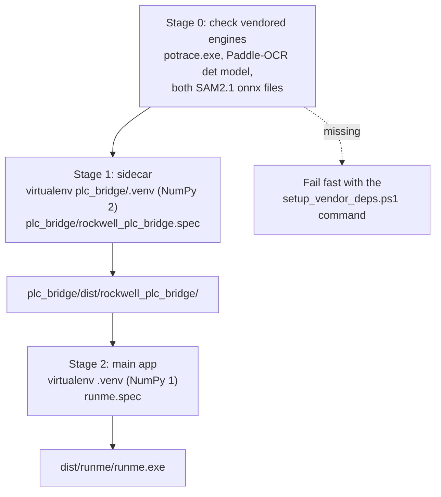

# Build and packaging

What a fresh clone is missing, how the two-stage build works, and what the
installed application looks like on disk.

---

## A fresh clone is not runnable

Several directories the application needs are deliberately not in git: the
engines are large binaries, and the models are mirrored rather than vendored.
`build_scripts/setup_vendor_deps.ps1` fetches them.

```powershell
powershell -ExecutionPolicy Bypass -File build_scripts/setup_vendor_deps.ps1
```

| Fetched | From | Lands in |
| --- | --- | --- |
| Potrace 1.16 | `potrace.sourceforge.net` | `Potrace/` |
| Paddle-OCR models (`cls`, `det`, `rec`, `layout`, `table`) | Resolved from the installed `paddleocr` package by `fetch_paddle_models.py` | `Paddle-OCR/` |
| SAM2.1 encoder and decoder ONNX | A mirrored Hugging Face repository | `SAM2.1/` |
| Ollama for Windows | The pinned GitHub release asset | `Ollama/` |

Every download is checked against a SHA-256 pinned in `$Sources`, and the
script refuses to install an artifact that does not match. Each engine has a
sentinel file in `$Sentinels`, so re-running is cheap and idempotent. Pass
`-Force` to refetch.

!!! warning "Ollama is unpacked in place, not replaced"
    `Install-Ollama` expands the zip straight into `Ollama/` rather than
    clearing the directory first, because `Ollama/models/` holds pulled model
    blobs, several gigabytes that do not come from that zip and must not be
    deleted.

---

## The two-stage build

```powershell
powershell -ExecutionPolicy Bypass -File build_scripts/build_all.ps1
```



Stage 0 exists because `runme.spec` bundles the engine directories wholesale.
Without it, a missing model produces a build that succeeds and then silently
ships an app with no OCR.

The two virtual environments are not a convenience. The Rockwell SDK wheels need
NumPy 2; `paddleocr`, `imgaug`, `opencv-python` and `numba` pin it below 2.
That conflict is the entire reason the PLC bridge is a separate executable.

`-SkipPlcBridge` omits stage 1. `runme.spec` bundles the sidecar only if its
output directory exists, so stage 2 still produces a working `runme.exe`, just
one where Build PLC shows an install hint.

!!! note "`pkg_resources` guard"
    Stage 2 checks that the main environment can `import pkg_resources` before
    starting. The PyInstaller hooks for paddle and paddleocr import it at build
    time, and setuptools ≥ 81 removed it; without the guard the build dies much
    later with a cryptic `ModuleNotFoundError`. The fix is
    `pip install "setuptools<81"`.

### What `runme.spec` bundles conditionally

| Bundled if present | Otherwise |
| --- | --- |
| `build/docs_site/` → `_internal/docs/site/` | Warns; Help → Documentation has nothing to open. |
| `plc_bridge/dist/rockwell_plc_bridge/` → `_internal/rockwell_plc_bridge/` | Warns; Build PLC shows an install hint. |
| `genai_bridge/src` on `pathex` plus `genai_bridge/.env.prod` → `_internal/.env.prod` | Warns; inference falls back to Ollama or public OpenAI. |

!!! danger "Keep `datas` a literal list"
    `tests/integration/test_frozen_build_smoke.py::test_spec_declared_top_level_datas_all_landed`
    regex-matches `^datas = (\[.*?\])$` in the spec and `ast.literal_eval`s the
    result. Putting an `os.path.join(...)` call inside that first assignment
    breaks the test. Add computed entries with `datas += [...]` afterwards,
    which is what every block below it already does.

---

## Documentation

This site is built separately and bundled into the exe.

```powershell
python build_scripts/build_docs.py          # build to build/docs_site/
python build_scripts/build_docs.py --serve  # live preview on 127.0.0.1:8000
python build_scripts/build_docs.py --clean  # full rebuild
python build_scripts/build_docs.py --check  # mkdocs --strict, for CI
```

Run `--check` before committing documentation changes: it fails on broken
internal links and pages missing from the nav, and nothing in the pytest suite
covers that.

Two settings in `mkdocs.yml` exist purely because the site is read from
`file://` inside the installed app, and both are easy to break:
`use_directory_urls: false`, and the `offline` plugin, which inlines the search
index because a `fetch()` of `search_index.json` is blocked by CORS on
`file://`. The `privacy` plugin vendors external assets for the same reason.
The theme feature `navigation.instant` is deliberately left out, because it
fetches pages over XHR.

---

## The installer

`build_scripts/package_installer.iss` is compiled with Inno Setup. It derives
the repository root from its own location:

```pascal
#define RepoRoot ExtractFileDir(ExtractFileDir(SourcePath))
```

!!! note "Output path"
    The installer sources the app from `dist\runme\`, the spec default that
    `build_all.ps1` writes to. The older `build_scripts/build.py`,
    `complete_build.py` and `build_no_console.py` drivers pass
    `--distpath=./build/dist` instead; do not package after running those, or
    the `.iss` will pick up whatever stale tree is still sitting in
    `build\dist\runme\`.

Beyond the frozen app, the installer adds the ACM libraries from
`acm_libraries/`, the demo documents, `Ollama\ollama.exe` with its `lib`
directory, a file association for `.aip` project files, and the Start menu and
optional desktop shortcuts. Its `[Dirs]` section grants everyone full control
over the directories the app writes to (`_internal\temp`, `_internal\projects`,
`acm_libraries`, and the Ollama model store) because the install target is
under `Program Files`.

### Installed layout

```text
C:\Program Files\Solutions Project Accelerator\
├─ runme.exe
├─ _internal\
│  ├─ docs\site\                   the documentation you are reading
│  ├─ rockwell_plc_bridge\         the PLC SDK sidecar
│  ├─ Paddle-OCR\  SAM2.1\  Potrace\
│  ├─ Ollama\                      ollama.exe, lib\, models\  (writable)
│  ├─ temp\                        config.ini, logfile.log    (writable)
│  ├─ projects\                    user projects              (writable)
│  ├─ .env.prod                    only when genai_bridge was bundled
│  └─ ...                          Python runtime and dependencies
├─ acm_libraries\
│  └─ ApplicationCodeManagerLibraries\   the (SPA) .HSL4 libraries
└─ demo\                           sample P&ID and control philosophy
```

The writable directories sit **inside** the installation, not in `%APPDATA%`.
That keeps a project self-contained and portable, and it is why the `[Dirs]`
permissions above matter.
