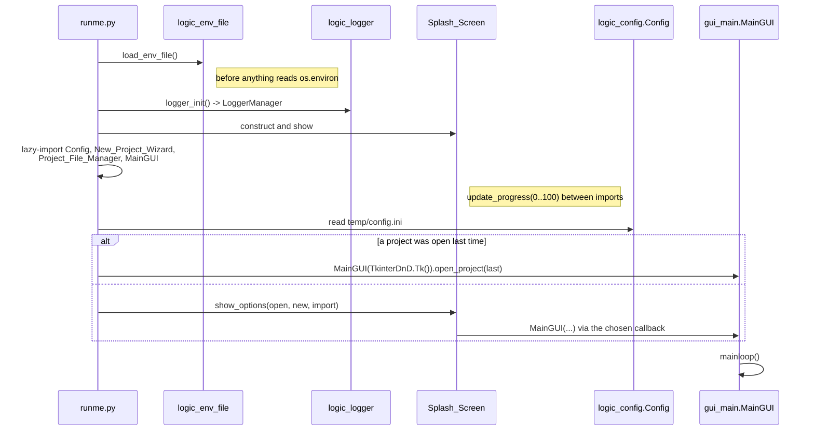
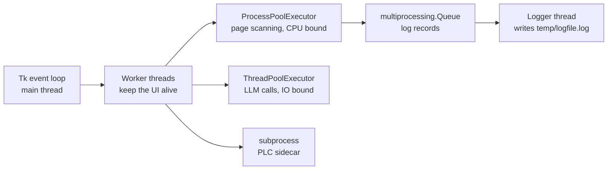

# Code map

Where things live in `bin/`, how the application boots, and the conventions you
need to follow when adding to it.

---

## Startup

`runme.py` is deliberately thin. It gets the window on screen as fast as
possible and defers every expensive import until the splash screen can show
progress for it.

Three details in that sequence are load-bearing:

- `load_env_file()` runs at module import, before any other `bin` module is
  imported, because deployment settings are read from `os.environ` at import
  time elsewhere.
- `import pip_system_certs.wrapt_requests` is the first real import in the
  file. It makes `requests` trust the Windows certificate store, which is what
  lets the app work behind a TLS-inspecting corporate proxy.
- `sys.stdout` and `sys.stderr` are redirected to `os.devnull` when they are
  `None`. In a windowed PyInstaller build there is no console, and any stray
  `print()` would otherwise crash the app.

The main window is always `MainGUI(TkinterDnD.Tk())`. The `tkinterdnd2` root
is what gives the app drag-and-drop of documents.

---

## The `bin/` package

There is no deep package hierarchy. `bin/` is flat, and the prefix on the
filename is the layer.

| Prefix | Count | Contains |
| --- | --- | --- |
| `gui_*.py` | 63 | Tkinter widgets, canvases, dialogs, menus, views. |
| `logic_*.py` | 53 | Headless logic: scanning, OCR, export, database, integrations. |
| `data_models.py` | 1 | The dataclasses that both layers exchange. |

`bin/data/` holds bundled JSON data that ships with the code, such as
`library_symbol_anchor_overrides.json`.

The prefix describes intent, not an enforced boundary. The direction of
dependency is normally `gui_* → logic_*`, and the modules that do the heavy
lifting (scanning, OCR, export, the database) are import-clean of Tkinter,
which is what makes them usable from worker processes and from the test suite.

Nine `logic_*` modules do import `gui_*`, and they are the domain-object
modules: `logic_control_module.py`, `logic_hmi_display.py`,
`logic_static_graphic.py`, `logic_linked_graphic.py` and `logic_linked_text.py`
each own both the object and the view that edits it. Treat those as UI modules
for dependency purposes. When adding new logic, prefer the callback style
below over importing a view.

### Modules worth knowing first

| Module | Responsibility |
| --- | --- |
| `gui_main.py` | `MainGUI`: the main window, project lifecycle, menu wiring. |
| `logic_config.py` | `Config`: application settings in `temp/config.ini`. |
| `logic_logger.py` | `logger_init()` and `LoggerManager`: queue-based logging. |
| `logic_file_manager.py` | `Project_File_Manager`: project folders, import and export. |
| `logic_internal_database.py` | `Database`: the per-project TinyDB store and its change subscriptions. |
| `logic_linked_graphic_scanner.py` | `linked_graphic_scanner`: the scanning engine and its process pool. |
| `logic_linked_graphic.py` | Graphic-to-object pairing, template flip and rotation. |
| `logic_control_module.py` | Process objects linked to drawings. |
| `logic_hmi_display.py` | An HMI display and everything placed on it. |
| `logic_extract_hmi_graphic.py` | Pulling SVG graphics out of a PDF region. |
| `logic_tools.py` | Top-level orchestration: `start_build_hmi()`, `start_build_plc()`, the exporters. |
| `logic_acm_data_handler.py` | `ACM_Data_Handler`: the Application Code Manager SQL Server database. |
| `logic_llm_inference.py` | `UnifiedInference` and the provider classes. |
| `logic_plc_bridge.py` | `run_bridge()`: the sidecar shim. |

---

## How the UI and the logic layer talk

Four patterns, in rough order of how often you will meet them.

**Direct call.** A widget calls a `logic_*` function and blocks. Fine for
anything that finishes in a frame or two.

**Worker thread.** Anything slower runs in a `threading.Thread` so the Tk event
loop keeps painting. The thread must not touch widgets directly.

**Progress callback.** Long-running logic takes a callable with the signature
`progress_callback(textbox_text, label_text, percentage)` and calls it as it
works. The orchestration entry points in `logic_tools.py` take a
`progress_update_and_check_if_should_stop` callback, which does double duty: it
reports progress *and* **returns `True` when the user has pressed stop**, so the
operation is cancellable without a separate flag. The implementation behind it
is `texbox_progressbar_window` in `bin/gui_textbox_progressbar_window.py`,
which owns the progress window, the `function_control` stop flag, and the
`ProcessCancelled` exception that workers raise to unwind.

**Database subscription.** Views that must stay in sync with project data
register with `Database`, for example
`subscribe_linked_text_regex_table(func)`, and are called back when that table
changes, rather than polling or being refreshed by whichever code did the
write.

---

## Concurrency

The app mixes three concurrency mechanisms, each for a different reason.

Worker counts are set in three different places, and they do not share a
setting:

| Where | Pool | How the count is chosen |
| --- | --- | --- |
| `logic_linked_graphic_scanner.py` | `ProcessPoolExecutor` | `_calculate_max_workers()`, derived from free memory (roughly 1.5 GB per worker, via `psutil`) and CPU count, capped at 4. Falls back to a CPU-only estimate if `psutil` is unavailable. |
| `logic_pair_control_modules_graphics.py` | `ProcessPoolExecutor` | `cpu_count() - 4`, or 1 on machines with four cores or fewer. |
| `logic_text_document_llm_processors.py` | `ThreadPoolExecutor` | Fixed at 5. |

Scanning is the only part that genuinely needs processes: it is CPU-bound
OpenCV work, so the GIL would serialise it. The memory-derived cap exists
because each worker renders full pages at 2× zoom and matches the template once
per rotation and flip variant, so peak memory scales with worker count rather
than with time.

### Logging across processes

`logger_init()` installs a `logging.handlers.QueueHandler` on the root logger
and starts a listener thread (`_lt`) that drains the shared queue in
`bin/logic_globals.py` and writes the records out. Worker processes inherit the
handler, so their records travel over the queue instead of fighting over the
log file. The sink is a `RotatingFileHandler` on `temp/logfile.log`, 10 MB per
file with six backups. `runme.py` calls `logger_manager.terminate_logger()` on
the way out, which joins the listener thread so nothing is lost at shutdown.

In a windowed build there is no console, so `temp/logfile.log` is the only
place output lands.
