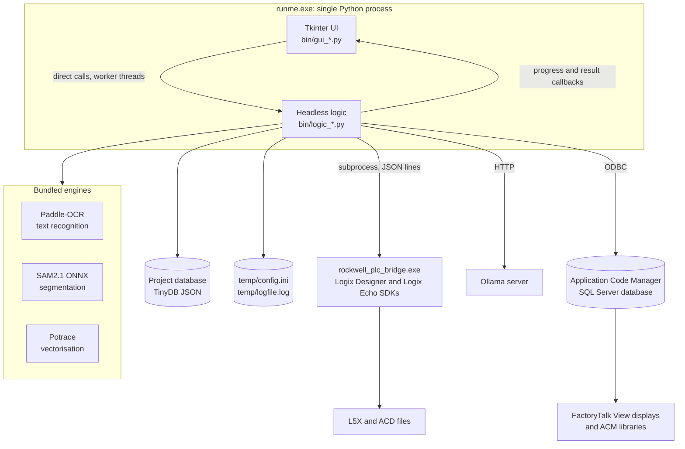

# Architecture overview

!!! note "Internal documentation"
    This section describes how the application is put together, for developers
    and integrators working on the code. It tracks the current build
    and will change between releases.

Solutions Project Accelerator (SPA) is a **single-user Windows desktop
application**. Everything runs locally: the Tkinter user interface, the vision
and OCR engines, the project database, and (unless you point it at a remote
endpoint) the language model. There is no server to deploy and no shared
runtime state.

Only two things run outside the main process:

- **`rockwell_plc_bridge.exe`**, a sidecar that owns the Rockwell .NET SDKs.
  It exists because those SDKs require NumPy 2 while the vision stack in the
  main app is pinned below it.
- **Ollama**, a local HTTP server used for language-model inference, started on
  demand from the bundled executable.

Everything else is one Python process.

---

## The pieces

---

## Top-level layout

| Path | In git | Purpose |
| --- | --- | --- |
| `runme.py` | yes | Entry point: environment, logging, splash screen, then the main window. |
| `bin/` | yes | The application itself: 63 `gui_*.py` modules and 53 `logic_*.py` modules. |
| `plc_bridge/` | yes | Source for the sidecar exe. The code lives under `plc_bridge/src/`. |
| `build_scripts/` | yes | Vendor bootstrap, two-stage build, Inno Setup script, docs build. |
| `acm_libraries/` | yes | ACM design-pattern libraries (`.HSL4`) that the installer ships. |
| `demo/` | yes | The sample P&ID and control philosophy used by [Getting started](../getting-started.md). |
| `tests/` | yes | The pytest suite. |
| `docs_src/` | yes | The source of this documentation site. |
| `Paddle-OCR/`, `SAM2.1/`, `Potrace/`, `Ollama/` | no | Vendored engines and models, fetched by `build_scripts/setup_vendor_deps.ps1`. |
| `genai_bridge/` | no | Optional enterprise LLM gateway. It lives in its own repository. |
| `projects/` | no | User data, one folder per project. |
| `temp/` | no | Runtime state: `config.ini` and `logfile.log`. |
| `build/`, `dist/`, `output/` | no | Build and export output. |

The ignored directories are not optional extras: without the vendored engines
the app builds and starts, but scanning produces nothing. See
[Build and packaging](build-and-packaging.md).

---

## Where to go next

- [Code map](code-map.md): how the app starts, how `bin/` is organised, and
  how the UI and the logic layer talk to each other.
- [Processing pipeline](pipeline.md): the route from a PDF page to a built
  HMI display or PLC project, stage by stage.
- [Data and state](data-and-state.md): the project database, the data models,
  and where every piece of state is written.
- [Integrations](integrations.md): the PLC sidecar, the language-model stack,
  and the Rockwell tooling SPA talks to.
- [Build and packaging](build-and-packaging.md): vendored dependencies, the
  two-stage build, and the installed layout.
