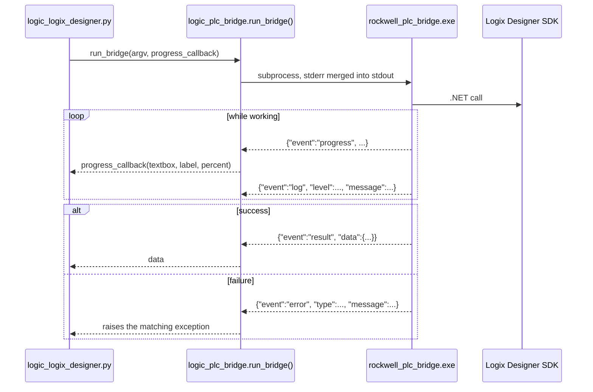
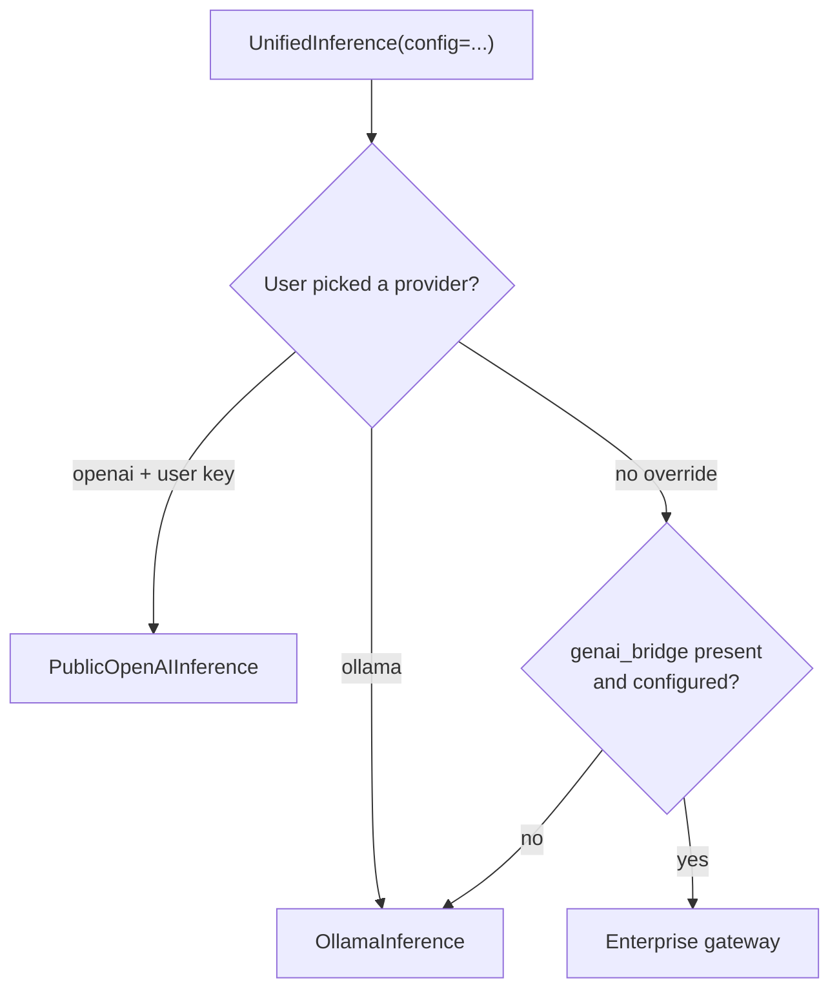

# Integrations

The three things SPA talks to that it does not own: the Rockwell .NET SDKs, a
language model, and the Application Code Manager database.

---

## The PLC bridge sidecar

`rockwell_plc_bridge.exe` is a second executable that ships inside the main
one. It exists for a dependency reason, not an architectural one: the Rockwell
`logix_designer_sdk` and `ftecho_sdk` wheels require NumPy 2, while the vision
stack in the main app (`paddleocr`, `imgaug`, `opencv-python`, `numba`) pins
NumPy below 2. The two cannot live in the same interpreter, so the SDK code is
built separately and driven as a subprocess.



### The protocol

One JSON object per line on stdout, with an `event` key. `progress` and `log`
are forwarded; `result` and `error` are terminal. Unknown event types are
logged at debug and ignored, so the sidecar can grow new ones without breaking
an older main app.

Two details are deliberate and easy to undo by accident:

- **stderr is merged into stdout.** A separate stderr pipe is 64 KB on Windows;
  if the sidecar filled it while the main app was reading stdout, both sides
  would deadlock.
- **Non-JSON lines are captured, not discarded.** They end up in
  `BridgeProtocolError` so a sidecar that dies before emitting a terminal event
  can still be diagnosed.

### Finding the exe

`resolve_bridge_exe()` probes, in order: `sys._MEIPASS`, then `_internal/` and
the directory next to `sys.executable` when frozen, then
`plc_bridge/dist/rockwell_plc_bridge/` when running from source. If none hit,
`BridgeExeNotFoundError` lists every path it checked and the exact PyInstaller
command that builds it. `bridge_available()` is the cheap check the UI uses to
decide whether to offer the Build PLC menu items at all. It looks for the file
without executing it.

### Callers

| Module | Uses the bridge for |
| --- | --- |
| `logic_logix_designer.py` | `convert_l5x_to_acd()`, `push_build_output_to_logix_designer()`, `is_sdk_available()`. |
| `logic_logix_echo.py` | Pushing a built project to a Logix Echo emulated controller. |

`logic_logix_designer.py` also translates bridge failures into domain
exceptions, `LogixDesignerSdkNotFoundError` and
`LogixDesignerServiceUnavailableError`, so the UI can tell "you never
installed it" apart from "the service is not running".

!!! note "Builds without the sidecar"
    `build_all.ps1 -SkipPlcBridge` produces a working `runme.exe` without it.
    `runme.spec` bundles the sidecar only when its output directory exists, and
    the Build PLC menu items fall back to an install hint.

---

## Language model inference

`logic_llm_inference.py` presents one class, `UnifiedInference`, over three
back ends. It constructs its clients on a daemon thread so opening a view that
might use the model does not stall the UI; `init_clients_done` and the
`init_done_subscribers` list are how callers wait for it.

| Class | Back end |
| --- | --- |
| `OllamaInference` | Local Ollama, or a remote server if a `base_url` is set. |
| `PublicOpenAIInference` | `https://api.openai.com/v1` with a user-supplied key. |
| Enterprise gateway | `InternalOpenAIInference`, loaded from `genai_bridge` if present. |

### Provider resolution

`_resolve_from_config(provider, config, kwargs)` decides. With no `Config` the
default is Ollama. With a `Config` and no explicit user override, it tries the
enterprise gateway first and `init_clients()` falls back to Ollama when the
plugin is absent or unconfigured. A user-supplied OpenAI key switches
`openai_mode` from `internal` to `public`.



### Ollama

`Ollama_Manager` starts the bundled `Ollama\ollama.exe` as a subprocess and the
client talks to it over HTTP. `check_model()` looks for the model blob under
`Ollama/models/blobs/`, which is how the app knows whether a model still needs
pulling. Passing `manage_server=False` (or an explicit `base_url`) leaves the
server alone, which is what you want when pointing at a shared Ollama host.

### The enterprise gateway

`load_enterprise_inference_class()` imports `InternalOpenAIInference` from
`genai_bridge` and returns `None` if it is not importable. The package lives in
its own repository and is git-ignored here; **no enterprise endpoint, tenant,
client ID or key appears in this repository.** Credentials come from
`genai_bridge/.env` in development, and in a frozen build from
`genai_bridge/.env.prod`, which is bundled to `_internal/.env.prod` and read by
`logic_env_file.py`. If either is missing, inference falls back to Ollama or a
public OpenAI key.

---

## Application Code Manager

ACM is the system of record for the generated objects. `ACM_Data_Handler` in
`logic_acm_data_handler.py` connects with SQLAlchemy over ODBC:

```python
connection_url = URL.create("mssql+pyodbc",
                            query={"odbc_connect": connection_string})
```

The connection string is a user setting, stored in the `[SQL]` section of
`temp/config.ini` and edited through the database connection dialog. A saved
SQL Server login password is kept out of the ini file in a DPAPI-encrypted
`temp/sql_password.dat` (see `logic_secret_store.py`).

| Module | Role |
| --- | --- |
| `logic_acm_data_handler.py` | Reads and writes the ACM SQL Server database. |
| `logic_acm_console.py` | Drives the ACM console for generation and export. |
| `logic_acm_library_parser.py` | Parses `.HSL4` library definitions and their parameters. |
| `logic_gfx_file_editor.py` | Edits FactoryTalk View `.gfx` displays: lines and connectors. |

The `.HSL4` libraries SPA generates against ship in `acm_libraries/` and are
registered by the installer. Their versions are pinned in `logic_config.py`
defaults such as `DEFAULT_ACM_HMI_TEMPLATE`; a library upgrade in ACM that SPA
has not been told about shows up as missing parameters at build time, not at
connect time.
