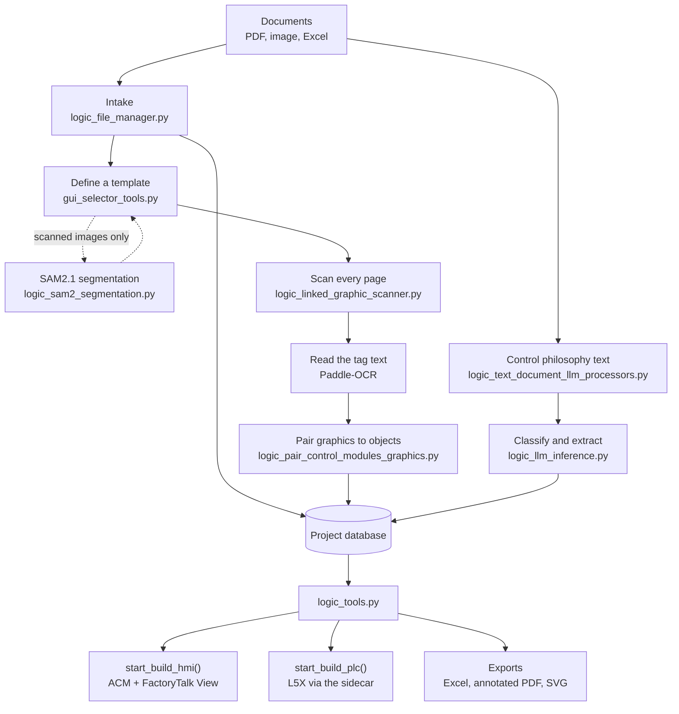

# Processing pipeline

How a document becomes a built HMI display or a PLC project, and which module
owns each step.

!!! info "Looking for the conceptual version?"
    [How scanning works](../user-guide/how-scanning-works.md) explains the
    vision technique itself: why it is a picture match, what it is good at,
    and where it breaks down. This page is the implementation map for the same
    pipeline.

---

## End to end

---

## Stage by stage

### 1. Intake

`logic_file_manager.Project_File_Manager` copies documents into the project
folder and records them in the `documents` table. Each one is tagged with a
type from `logic_internal_database.Database`: `DRAWING`, `IMAGE`, `TEXT` or
`TABLE`. The type decides which tools are offered later. Notably, the SAM2.1
segmentation model is only loaded for `IMAGE` documents.

### 2. Defining what to look for

`gui_selector_tools.py` is where you draw the template: the symbol itself, the
mask that says which pixels matter, and the text region beside it that holds
the tag.

For `IMAGE` documents (photographs and scans rather than vector PDFs),
`__load_ai_models()` instantiates `SAM2Image` from
`logic_sam2_segmentation.py`. SAM2.1 runs as two ONNX models,
`SAM2ImageEncoder` and `SAM2ImageDecoder`, and turns a click into a mask, so
you can lift a symbol out of a noisy scan without tracing it by hand. The
helpers in the same module (`simplify_mask_polygon`,
`process_mask_to_unified_polygon`, `unify_contours_with_connections`) reduce
that mask to a usable polygon.

### 3. Scanning

`logic_linked_graphic_scanner.linked_graphic_scanner` is the engine.
`multiprocess_search_document()` fans pages out across a `ProcessPoolExecutor`;
each worker runs `search_page_process()`, which renders the page with
`get_page_image()` (PDFium, 2× zoom) and hands off to `search_image()` for the
actual template match.

The caller does not block. `check_multiprocess_search_progress()` is polled
from the UI, `get_completed_results()` drains finished pages, and
`cancel_search_and_shutdown()` tears the pool down if the user stops.
`__check_for_exceptions()` re-raises anything a worker failed on, because a
silently dead worker would otherwise just look like a page with no matches.

### 4. Reading the tag

Text recognition is a separate pass with its own page render:
`get_ocr_page_image()` re-renders with hairline widths so drawing lines are not
mistaken for strokes of a character.

| Function | Does |
| --- | --- |
| `find_text_dict_within_roi_with_ocr()` | Crops the text region next to a match and drives the rest. |
| `run_paddle_ocr()` | Calls Paddle-OCR, handling horizontal and rotated text. |
| `process_paddle_ocr()` | Turns the raw result into per-character records. |
| `correct_character_regions()` | Repairs the character boxes against OpenCV contours. |
| `split_conjoint_characters()` | Separates characters that OCR merged into one box. |
| `letter_i_corrective_detector()`, `replace_with_letter_i()` | Recover thin glyphs such as `I` that OCR drops. |

That much correction exists because downstream the text is not just a label.
It becomes the object's tag name, so a single wrong character produces a wrong
object in ACM.

### 5. Pairing and linking

`logic_pair_control_modules_graphics.py` matches detected graphics to control
modules, in its own process pool.
`logic_linked_graphic.py` holds the pairing itself along with the flip and
rotation that were applied (`Template_Flip`, `Template_Rotate`).
`logic_process_line_extraction.py` traces the pipework between objects so
process lines can be drawn on the generated display.

### 6. Text documents and the language model

Control philosophies take a different route. `logic_text_document_llm_processors.py`
chunks the document and classifies the passages, using a `ThreadPoolExecutor`
of five workers because the calls are IO-bound.
`logic_ollama_parameter_extractor.py` then runs extraction over the classified
passages to pull out parameters and values.

The results land in the `unapproved_text_links` table and move to
`approved_text_links` or `rejected_text_links` as the user reviews them. The
model never writes directly into approved state. See
[Data and state](data-and-state.md).

### 7. Building

`logic_tools.py` is the orchestration layer. Everything here takes a
`progress_update_and_check_if_should_stop` callback so it can be cancelled.

| Entry point | Produces |
| --- | --- |
| `start_build_hmi()` | HMI displays in ACM, via `build_pages()` and `logic_acm_console.py`. |
| `quick_build_hmi_page()` | A single page, without the full build. |
| `auto_create_hmi_displays_for_scanned_pages()` | Displays for pages that were scanned but have none. |
| `create_alarms()`, `create_alarm_group()` | Alarm objects and groups against the ACM library. |
| `start_build_plc()` | PLC content, through the sidecar. See [Integrations](integrations.md). |

### 8. Exporting

| Entry point | Produces |
| --- | --- |
| `export_excel_with_data()` | A workbook of the project's objects and links. |
| `export_pdf_with_data()`, `export_text_pdf_with_data()` | The source PDFs annotated with what was found. |
| `export_images()` | The extracted graphics as SVG. |
| `export_reduced_images()` | The same graphics, simplified for an HMI. |

`export_reduced_images()` is where Potrace comes in. `reduce_svg_image()`
splits strokes from fills, rasterises each at eight times the display size with
cairosvg, and runs `Potrace\potrace-1.16.win64\potrace.exe` over the bitmap to
re-trace it. The round trip is deliberate: it collapses the thousands of tiny
segments a CAD export produces into something FactoryTalk View can render
without choking.
