# How to Create a Project

This section explains how to open SPA and create a new project.

## Opening SPA

Double-click the SPA shortcut on the desktop to open the application.

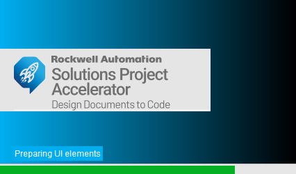

## Creating a New Project

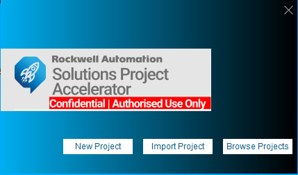When you open SPA for the first time, a splash screen displays the quick-start options.

Open the File menu and select New Project. In the Create New Project window, Project Name is required; Project Description and Project ID are optional.

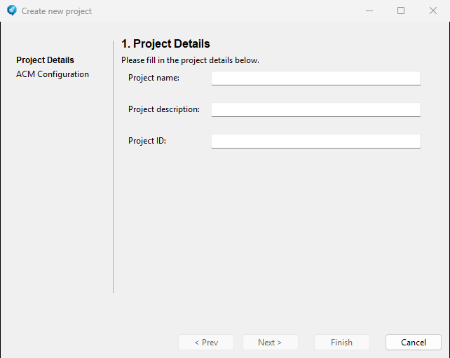

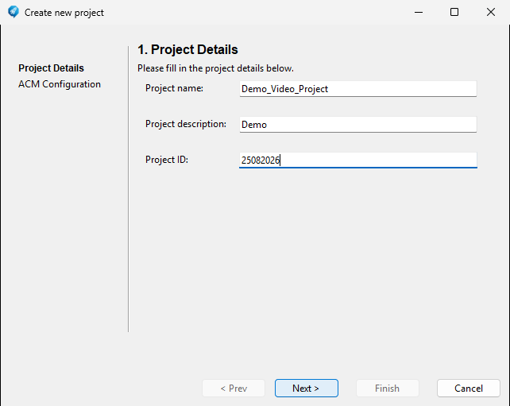Enter the project name and, if applicable, the project description and project ID.

Select Next. The Studio 5000 Application Code Manager (ACM) configuration page appears. If SPA is not connected to an ACM database, the page is blank and displays a connection warning.

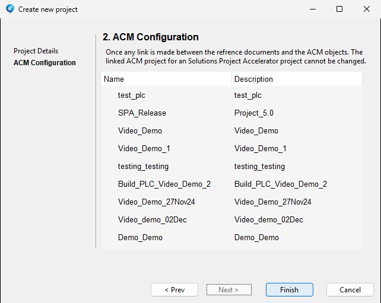

> Select Finish to create and open the project.

The SPA workspace has three main sections.

1.  The Data and Documents section on the left displays files imported into SPA.

2.  The center section displays imported documents and lets you select source data.

3.  The section on the right displays the linked ACM project.

The right side also provides the Control Modules, Static Graphics, HMI Graphics, and Pending Approvals tools for linking imported data. Custom Objects and Custom Code are reserved for future use.

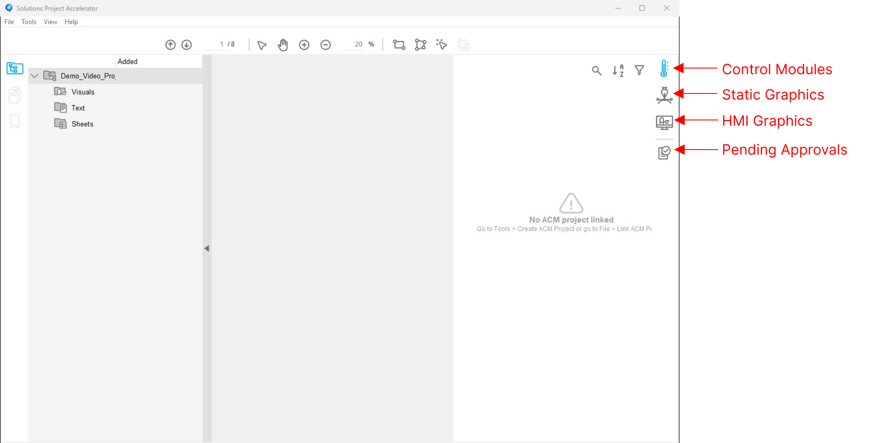

The ribbon provides Zoom In and Zoom Out, Page Navigation, Select and Hand tools, Region Selection, Segmentation, and Highlight Similar. Connect to Cloud is reserved for future use.

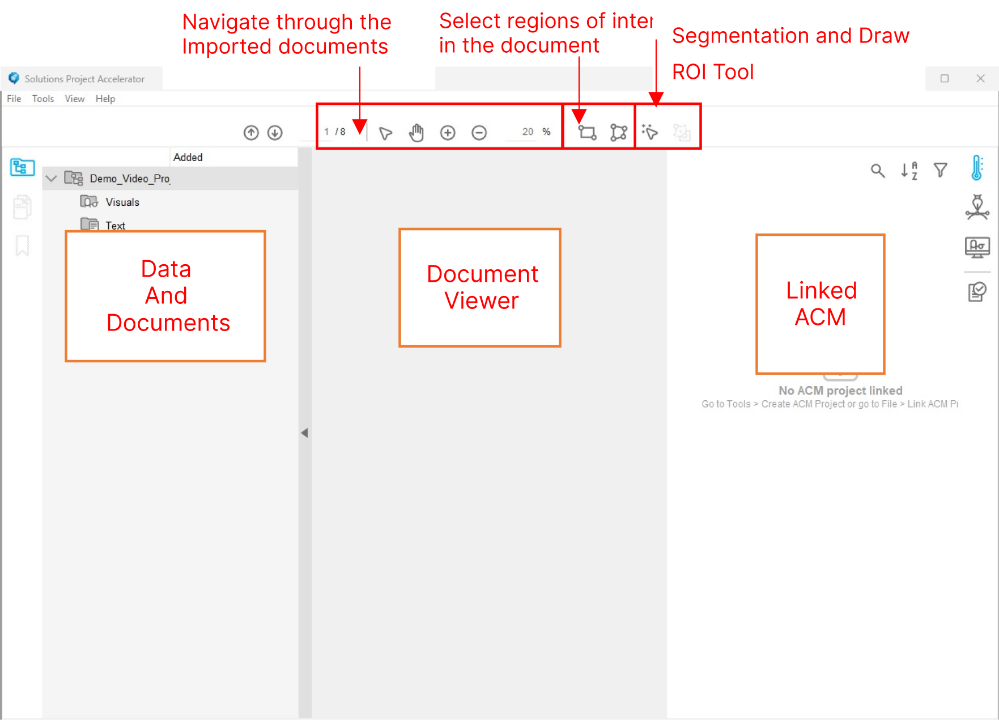

The Data and Documents section supports three document types:

- **Visuals:** documents that SPA searches for visual representations of objects or data, such as P&IDs.

- **Text:** documents that SPA searches for text representations of objects or data, such as control philosophies.

- **Sheets:** Excel workbooks that SPA searches using cell references.

To import a P&ID, **right-click Visuals** in the Data and Documents section, select **Import**, browse to the required PDF, and **open** it.

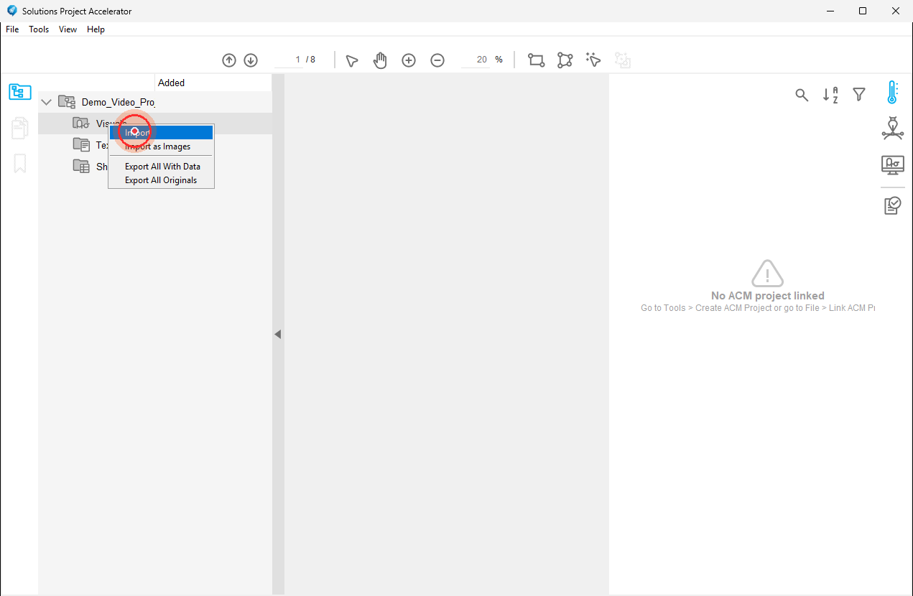

This example uses DEMO_P&ID.pdf, located in the demo folder of the supplied ZIP archive.

Select **DEMO_P&ID.pdf**.

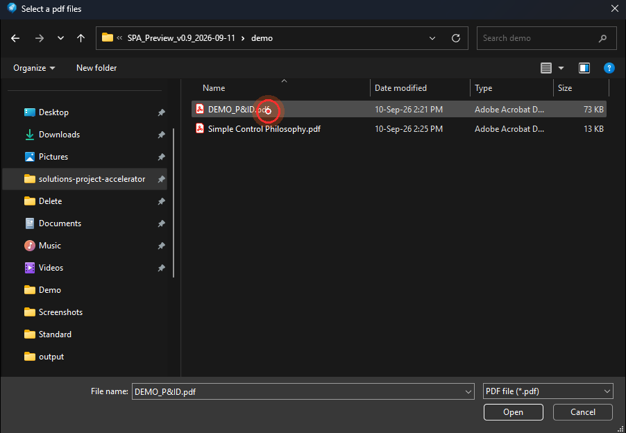

Select **Open** to import the file.

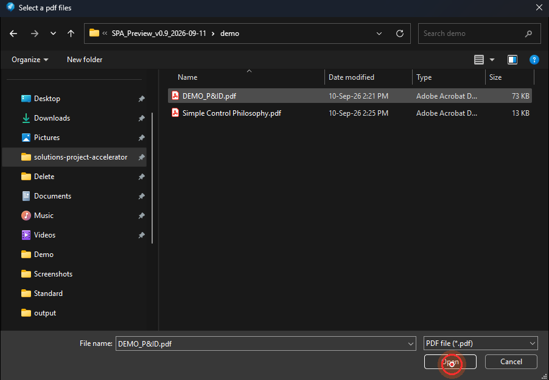

The imported file appears under **Visuals**.

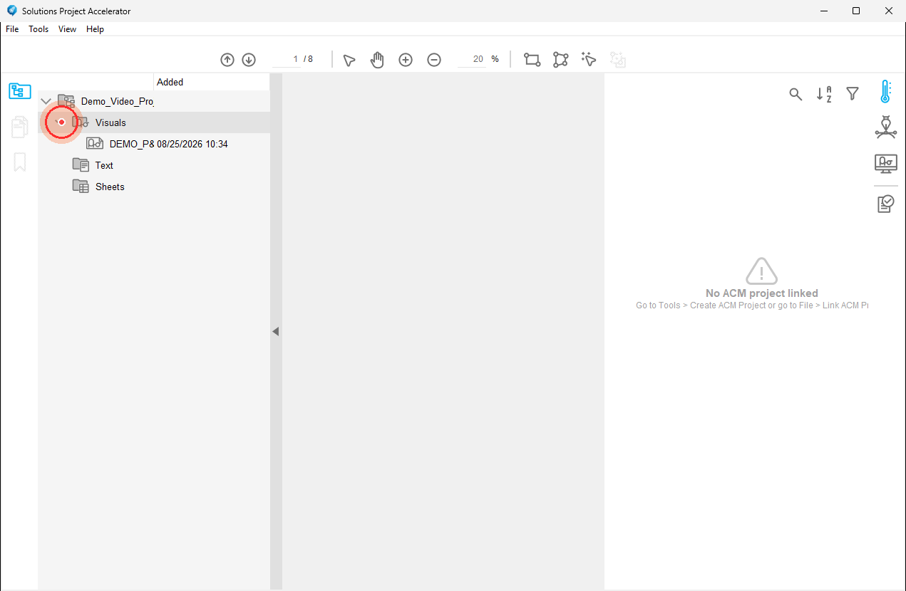

**Double-click** the imported file under **Visuals** to open it in the center **document viewer.**

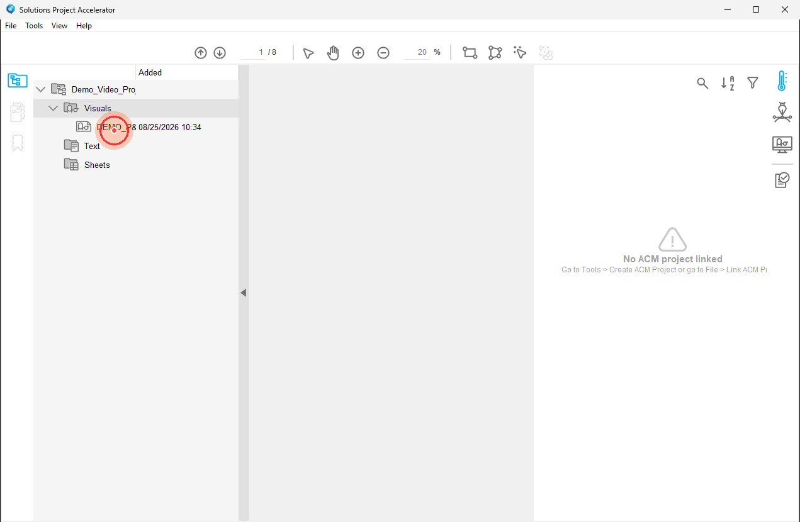

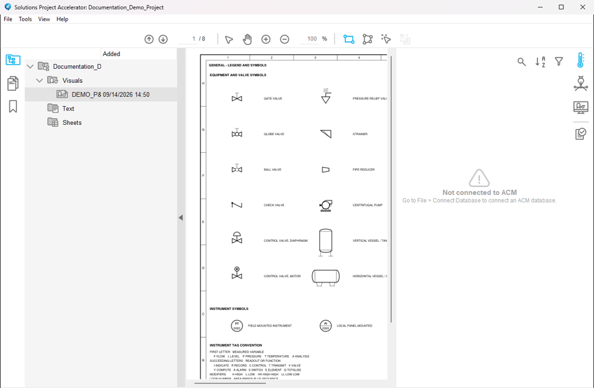
