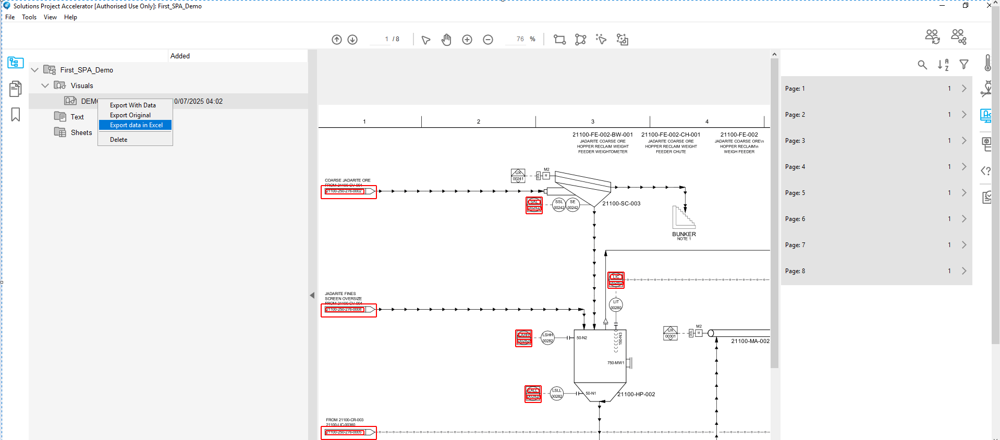
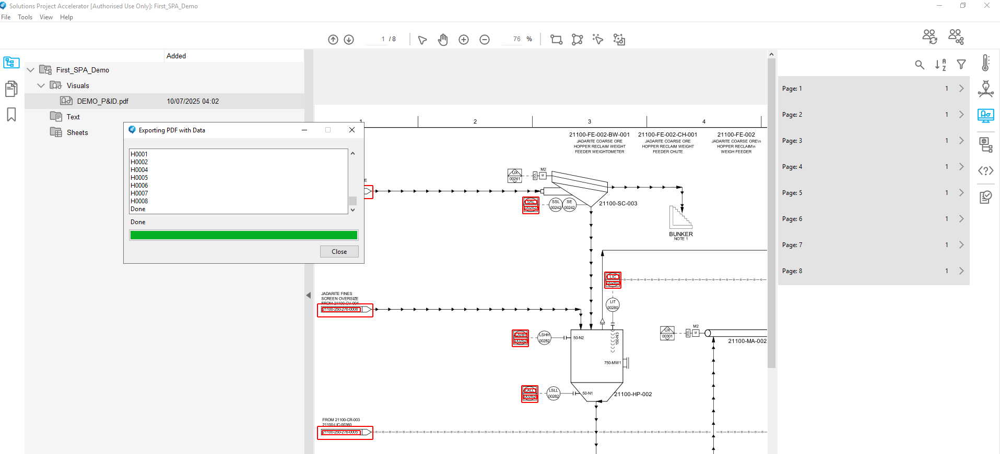
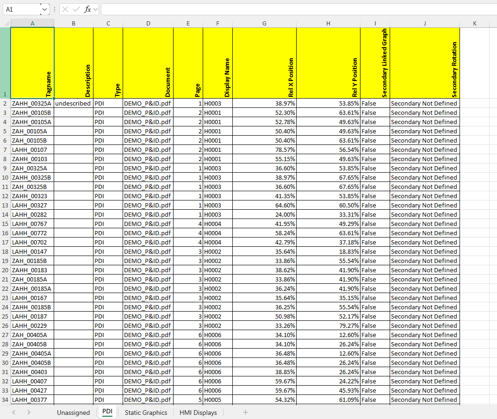
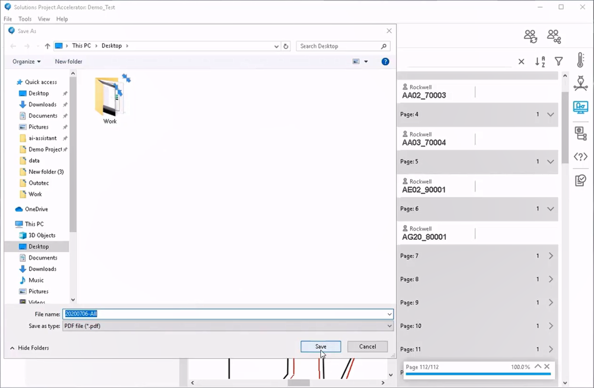
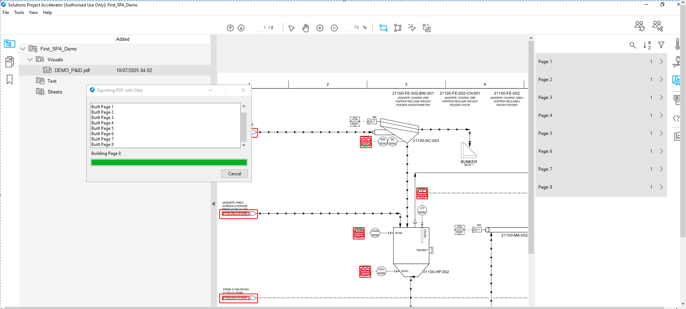
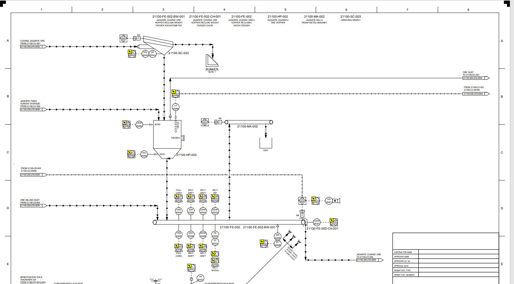
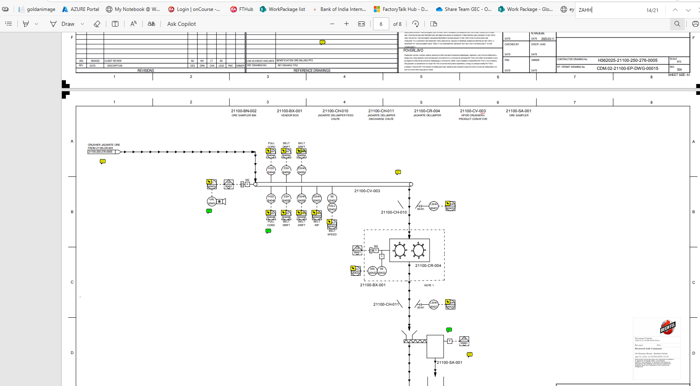
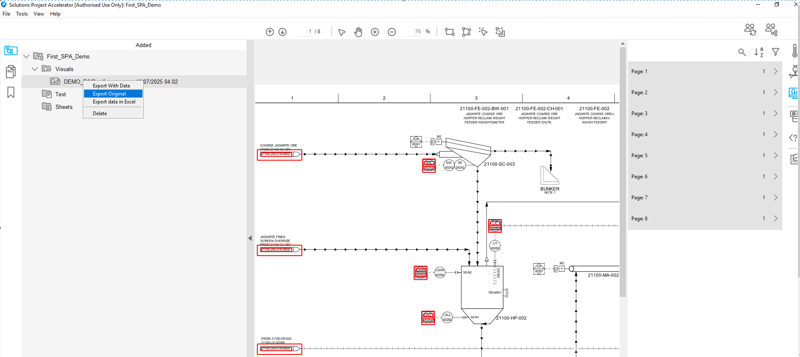
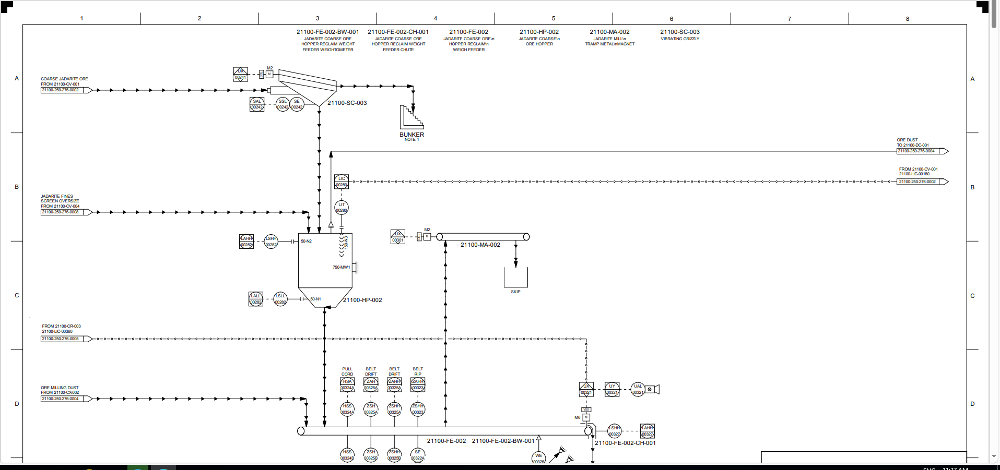

# How to Export Project Data

> SPA can export the data scanned in the previous sections in several formats. The project from the preceding HMI workflow contains valve, static-graphic, HMI display, and page-link data.
>
> Right-click the imported P&ID under Visuals to open the three export options.
>
> The available exports are:

- Export with Data: creates a PDF containing the P&IDs and the data generated in SPA.

- Export Original: reproduces the original imported P&ID as a PDF.

- Export Data to Excel: exports project data to an Excel workbook.

Select Export Data to Excel, enter a file name, and save the workbook in the project directory. A status window shows export progress.

The completed workbook contains several worksheets.

Each valve record includes the following data:

- P&ID drawing.

- Relative position.

- Secondary graphic, if applicable.

Use the export to verify both the extracted data and the accuracy of the template scans.

Select Export with Data, enter a PDF file name, and save it in the project directory.

The status window shows SPA building each page in the PDF. Open the completed file to review the exported P&ID drawings.

Hover over a device to view its attached valve, graphic, or page-link data. Open the Comments pane to see the same information. Use the search bar to find an object; selecting a result opens the correct page and location.

Selecting a page link opens the destination page specified by that link. Future SPA releases may include more device data in the comments.

Export Original creates a copy of the imported PDF without scanned data.

