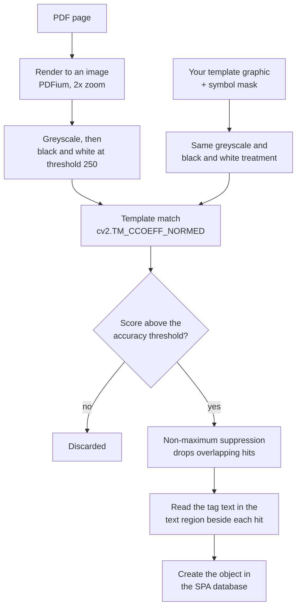
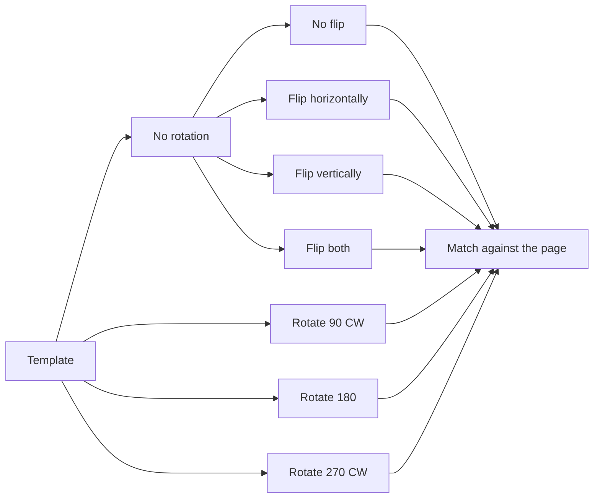
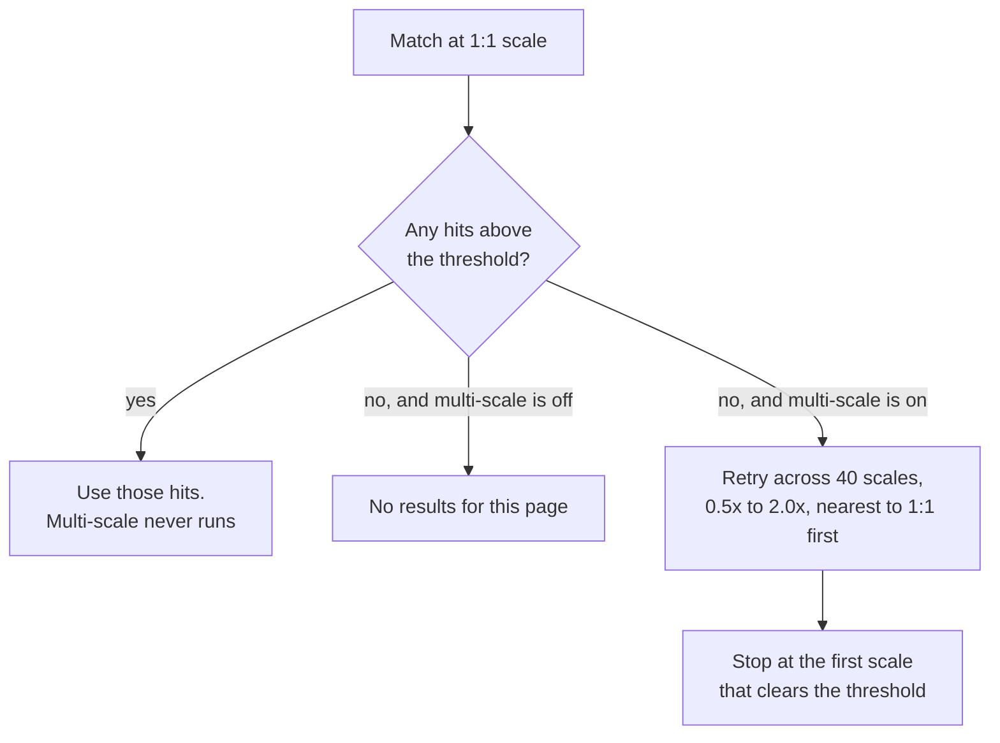
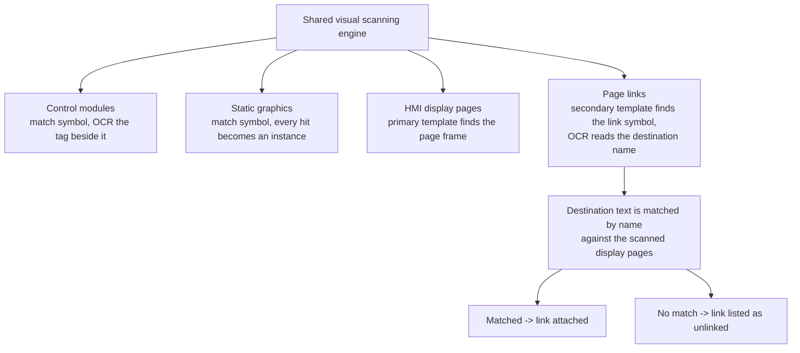

# How scanning works

Every "scan" in SPA — control modules, static graphics, HMI display pages and
page links — is driven by the same **visual** engine. SPA does not read the
intelligence out of a P&ID; it looks at a picture of the page and finds places
that look like the example symbol you gave it.

Understanding that one sentence explains almost every good and bad result you
will get from the tool, so this page walks through what actually happens and
where the technique runs out of road.

---

## The pipeline at a glance

Everything downstream — the control module list, the built displays, the ACM
export — is only ever as good as the match in the middle of that diagram.

---

## Stage by stage

### 1. The page becomes a picture

SPA renders each PDF page with PDFium at a **2× zoom** (roughly 144 DPI for a
standard page). Vector content in the PDF is rasterised at that moment; from
here on SPA is working with pixels, not with CAD geometry, text objects or
layers.

If a page has a drawing border, SPA can crop to the drawing frame first so the
title block does not dominate the image.

For the text-reading pass, SPA renders the page a second time with every line
width in the PDF content stream forced down to `0.1`. Hairline drawing lines
are far less likely to be mistaken for characters.

### 2. The picture becomes black and white

Both the page and your template are converted to greyscale and then hard
thresholded at **250 of 255** — anything not almost-pure white becomes black.

This is deliberate: P&IDs are line drawings, and throwing away every shade of
grey makes the match insensitive to how the PDF was produced. The cost is that
faint, grey or low-contrast content is erased before matching even starts.

### 3. The template is matched against the page

SPA slides your template across the page and computes a normalised correlation
score (`cv2.TM_CCOEFF_NORMED`) at every position. The **mask** you draw around
the symbol tells the match which pixels count, so the tag text that sits inside
the template's bounding box does not have to match.

A single scan pass repeats the whole match once per orientation you enabled:

You choose those rotation and flip variants yourself before running the scan.
SPA does not discover them for you, and every extra variant multiplies the scan
time.

### 4. Duplicate hits are removed

Strong matches produce a cluster of high-scoring pixels, so SPA applies
**non-maximum suppression** — first within each rotation/flip variant, then
across all of them — keeping the highest-scoring box out of each overlapping
group. A hit that overlaps an existing object by more than 80 % on the same
page is rejected as a duplicate.

### 5. The tag is read

For each surviving match, SPA takes the **text region** you drew relative to the
template, translates it to the match's position on the page, and reads it.

- If the PDF has real text objects there, SPA prefers them — they are exact.
- Otherwise it runs **PaddleOCR** (English, local models in `Paddle-OCR/`).

Before OCR, the cropped region is cleaned up: non-text areas are masked to
white, small contours touching the edges are removed, a 5 px white border is
added, and thin strokes are thickened to about 1.5 px. SPA aims for roughly
**30 px character height**; if the characters come out smaller it re-renders the
page at a higher zoom and tries again.

---

## What the two scanning settings actually do

**Settings → Scanning Options**

| Setting | Values | What it changes |
|---|---|---|
| **Scanning Accuracy** | High `0.7`, Medium `0.6`, Low `0.5` | The minimum correlation score a location must reach to be accepted as a match. |
| **Use multi-scale scanning** | On / Off | Enables a fallback search across 40 scales from 0.5× to 2.0× when the normal pass finds nothing. |

Two things about multi-scale scanning are worth knowing:

It is a **fallback**, not an always-on behaviour, and it stops at the *first*
scale that works rather than finding the best one. It is also much slower, so
leave it off unless a scan legitimately returns nothing.

Lowering accuracy to Medium or Low does not make SPA smarter — it makes it less
fussy. Expect more false positives that you then have to delete by hand.

---

## How each scan type uses the engine

- **Control modules** and **static graphics** differ only in what SPA creates
  from a hit — the matching is identical. Static graphic scanning is purely
  image-based; it does not search for words.
- **Page links** depend on two things going right: the link symbol has to match
  *and* the destination text has to read correctly and correspond to a display
  page name. A page link whose text is misread will show up as unlinked.

---

## Limitations of the technology

The engine is **rigid** by design. It is pixel-pattern matching, not drawing
comprehension, and that gives it a very specific failure profile.

| Limitation | Why it happens | What to do about it |
|---|---|---|
| **No understanding of the drawing** | SPA correlates pixels. It has no concept of a valve, a line or a loop. | Always review scan results; treat them as a first pass, not a finished answer. |
| **Symbols must be drawn consistently** | A symbol redrawn with a different line weight, proportions or extra detail correlates poorly with your template. | Create a separate linked graphic per symbol style, or per drawing package/vendor. |
| **Only 0°, 90°, 180°, 270°** | Rotation is applied by whole-image rotation. A symbol at 45° will not be found at any threshold. | Nothing to tune — rotated-at-an-angle symbols must be added manually. |
| **Scale sensitivity** | The default pass matches at 1:1 only, and the fallback only covers 0.5×–2.0×. | Scan drawings at a consistent sheet size; enable multi-scale only when a scan returns nothing. |
| **Very small symbols** | Templates below 50 px in either dimension are unusable, so SPA zooms the page up, which costs memory and time. | Prefer templates taken from a clear, reasonably large instance of the symbol. |
| **Scanned or photographed PDFs** | Speckle, skew and blur survive the black-and-white conversion and destroy correlation. There is no deskew or denoise stage. | Use native vector PDFs wherever possible. Scanned drawings will give poor results. |
| **Faint or grey content** | The fixed threshold of 250 erases anything that is not near-black. There is no adaptive thresholding. | Re-export the PDF with stronger line contrast. |
| **Redlines, clouds and annotations** | Markup drawn over a symbol changes its pixels, so the match score drops below the threshold. | Scan a clean issue of the drawing, or add the affected items manually. |
| **Overlapping or touching symbols** | Non-maximum suppression keeps one box per overlapping group, and the 80 % overlap rule rejects the rest. | Check congested areas of the P&ID by hand. |
| **OCR is imperfect** | PaddleOCR is English-only, expects standard fonts and roughly 30 px characters. Handwriting and stylised fonts fail. Common confusions are `I`/`1`, `O`/`0`, `5`/`S`. | Check tag names after scanning, especially short tags and anything near a line crossing. |
| **Text must be inside the region you drew** | The text region is a fixed offset from the symbol. If a tag sits somewhere else on some instances, it is not read. | Keep the text region generous, or create a second linked graphic for the alternative layout. |
| **Page-link names must correspond** | Links are attached by matching the OCR'd destination text against display page names. | Correct unlinked page links manually after the scan. |
| **Time and memory** | Scanning runs at most 3–4 worker processes, and each page image is held in memory. Every rotation/flip variant and multi-scale mode multiply the work. | Enable only the orientations you actually need; expect long runs on large document sets. |

!!! tip "The practical rule"
    SPA finds things that look **the same** as the example you gave it. The more
    uniform the drawing set, the better it performs. On a mixed-vintage,
    multi-vendor, partly-scanned document set, expect to run several linked
    graphics and to correct results by hand.

---

## Getting the best results

1. Start from a **native vector PDF**, not a scan.
2. Pick your template from a **clean, typical, unannotated** instance of the
   symbol.
3. Mask **only the symbol**, and keep the tag inside the text region.
4. Enable only the rotations and flips that genuinely occur in the drawings.
5. Leave **Scanning Accuracy** on High. Drop it only if you are missing known
   instances, and re-check for false positives afterwards.
6. Leave **multi-scale scanning** off until a scan returns nothing.
7. Test on a single page first, then run the full document.
8. Review every result before building displays or exporting to ACM.
